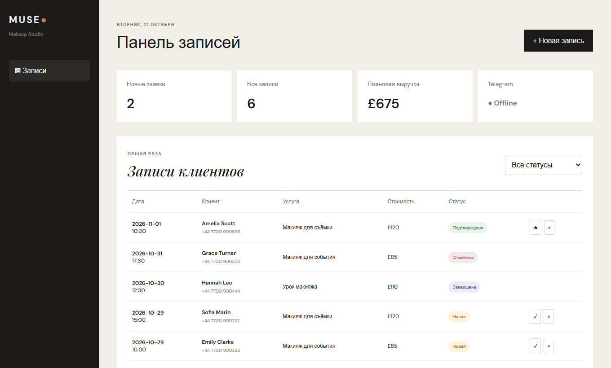

# MUSE — booking bot for a makeup studio

[](https://github.com/Kotoliji/muse-booking-bot/actions/workflows/test.yml)

A booking system for a London makeup artist with three interfaces on top of one bookings store:

- **Client Telegram bot**: pick a service, a date and a free slot, leave a name and phone number.
- **Telegram admin** (`/admin`): new and recent bookings, confirm or cancel in one tap; the client is notified automatically.
- **Web admin panel**: metrics, filters, manual bookings and status changes.

Node.js 20+ with **zero npm dependencies**: `node:http`, `node:test` and the Telegram Bot API called directly over `fetch`.



## How it works

```
Telegram ──long polling──► src/telegram.js ─┐
                                            ├─► src/store.js ──► data/bookings.json
Browser ──REST /api/*───► src/http.js ──────┘
```

- **Slot conflicts.** Every service has a duration, so a 3-hour bridal booking at 10:00 also blocks 12:30. The same check runs when the bot lists free times and inside `store.create`, so two clients racing for one slot cannot both get it.
- **Writes are serialized** through a promise queue and saved atomically (temp file + rename).
- **Security.** Admin access in Telegram is by numeric user ID, and it is checked on every admin callback because `callback_data` is client-controlled. The web API is locked until `ADMIN_KEY` is set, and the key is compared in constant time. Client input is whitelisted, while price and service name come from the server catalogue. User text is escaped both in the panel and in Telegram HTML messages.
- **Time zone.** Dates are computed in the studio's zone (`Europe/London` by default), not UTC.

## Run locally

```bash
cp .env.example .env    # then fill in the values
export $(cat .env | xargs)
npm start               # http://localhost:3000
```

Without `BOT_TOKEN` only the web panel starts, which is enough to try it out.

| Variable | Purpose |
| --- | --- |
| `BOT_TOKEN` | Token from @BotFather |
| `ADMIN_IDS` | Comma-separated numeric Telegram IDs of admins |
| `ADMIN_KEY` | Web panel key; the API stays locked without it |
| `PUBLIC_URL` | HTTPS address of the panel, shown as a button in the Telegram admin |
| `TZ_NAME` | Studio time zone, default `Europe/London` |
| `DATA_FILE` | Bookings file, default `data/bookings.json` |

## Tests

```bash
npm test
```

Store tests cover forged fields, statuses, duration-aware overlaps and concurrent writes. API tests cover auth, input whitelisting, validation, `409 slot_taken`, path traversal and health. CI runs them on Node 20 and 22.

## Limitations

This is a single-process prototype. Before production it would need PostgreSQL instead of the JSON file, persistent bot sessions, webhooks instead of long polling, and proper admin sessions instead of a key in `sessionStorage`.

The bot and panel UI are in Russian.

## License

MIT
